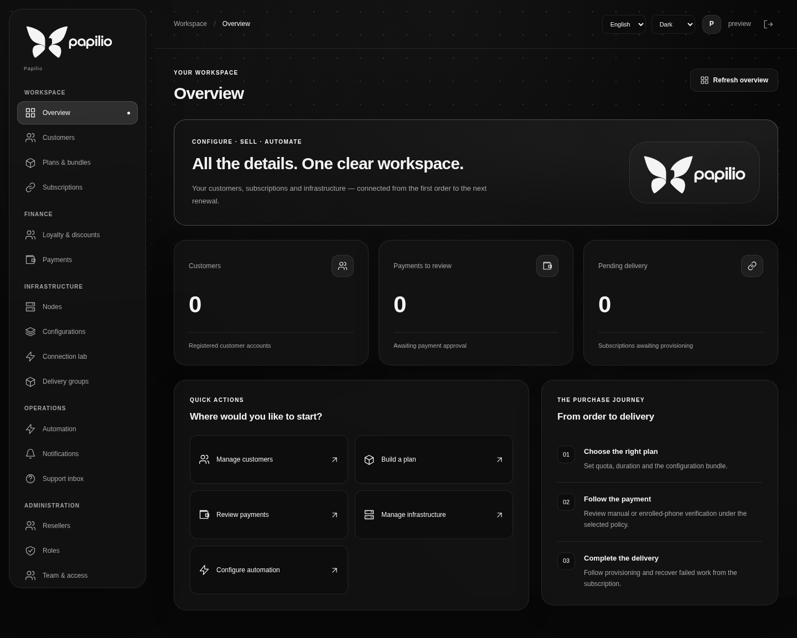
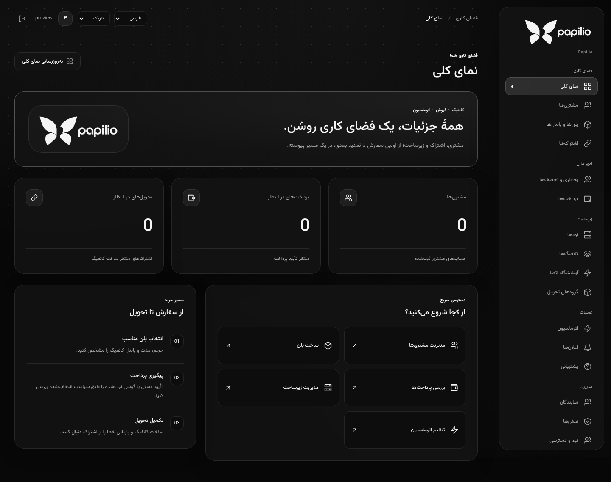
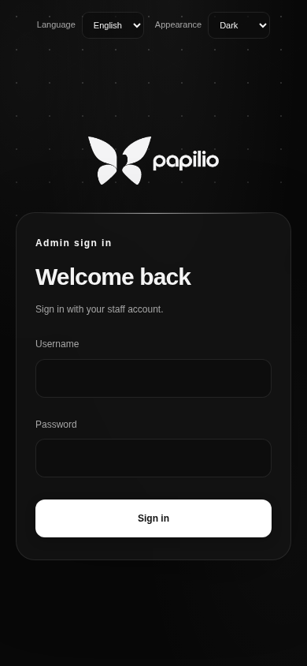

<p align="center"></p>

<h1 align="center">Papilio</h1>
<p align="center"><strong>Your infrastructure. Your subscriptions. One workspace.</strong></p>
<p align="center">An open-source, self-hosted platform for proxy configuration, subscription commerce and automation.</p>
<p align="center"><a href="README.md">English</a> · <a href="README.fa.md">فارسی</a> · <a href="docs/getting-started.en.md">Getting started</a> · <a href="docs/getting-started.fa.md">آموزش راه‌اندازی</a> · <a href="LICENSE">GPL-3.0-only</a></p>

> **Development preview.** Existing workflows and their limits are documented below. The bilingual theme redesign is available; full protocol enforcement and production operations are still being completed. The screenshots show the current application.

## Why Papilio?

Connect the work that usually spans customer records, a configuration panel,
payment review and a sales bot. Papilio brings these responsibilities into a
configurable API and workspace, with a thin Telegram adapter and separate node runtime.

- **Build the offer:** quota and duration, quota without expiry, or unlimited data with an expiry; one or more configurations per plan.
- **Follow the money:** captured receiving details, explicit rial amounts, wallet credit, checkout, refund and renewal records.
- **Automate with control:** editable schedules, policies and capacities, with review and recovery paths.
- **Keep your choices:** editable configuration JSON, business settings, API contracts and self-hosted data.

## Features

| Area | Current scope |
| --- | --- |
| Configuration workspace | Protocol settings, saved-settings and server-JSON editors, configuration bundles and core exports; runtime support depends on the target adapter and verification. |
| Customers and access | Customer records, assigned configurations, staff scopes, named roles and reseller capabilities. |
| Commerce | Wallet checkout, immutable purchased terms, renewal policies, recoverable fulfillment and refund paths. |
| Payment review | Card/IBAN/account destinations, manual review, optional four-digit rial identifiers and enrolled-phone SMS reconciliation. |
| Customer experience | Telegram purchase flows, QR images, usage information, trials, support, discount tiers and notices. |
| Operations | Native scheduled payment review, node health, checkout recovery and subscription attention. |

See the [feature reference](docs/feature-reference.en.md) for contracts, settings
and verification boundaries. An SMS source authenticates the enrolled phone;
ambiguous matches require review. A receipt image does not establish settlement.

## Architecture

| Application | Foundation | Responsibility |
| --- | --- | --- |
| Panel API | Papilio, Papilio Tasks, MySQL | Business contracts, authorization, durable records and automation |
| Administration | Vue 3 | Configuration, customers, commerce and operational workflows |
| Telegram | aiogram | Webhook and customer presentation, using the API's business capabilities |
| Node runtime | Go and core adapters | Node execution and enforcement, separately from the panel |
| Android SMS Bridge | Native Android | Filter, encrypt, queue and forward new bank SMS from an enrolled device |

## Screenshots

The redesigned interface below is the actual Vue application, captured with
controlled, empty API responses. These previews show appearance and draft controls;
they do not represent live customer counts, settlement or provisioning.

| Dark workspace | Light workspace |
| --- | --- |
|  |  |

| Persian workspace | Plan creation dialog |
| --- | --- |
|  |  |

<details>
<summary>Persian plan editor</summary>


</details>

<details>
<summary>Mobile sign-in</summary>



</details>

## Local setup

Learn the day-to-day workflows in the [user guide](docs/user-guide.en.md)
or [آموزش کار با پنل](docs/user-guide.fa.md).

Follow [Getting started](docs/getting-started.en.md) or [آموزش راه‌اندازی](docs/getting-started.fa.md).
The installer brings up the API, panel and native task services; Telegram is optional.
Proxy cores require their own deliberate setup and verification.

```bash
set -o pipefail; curl -fsSL https://raw.githubusercontent.com/stupidprogrammer4/papilio-proxy/main/scripts/deploy/quick-install.sh | bash -s -- --public-url https://panel.example.com --owner-username admin
```

Point the domain to the server and allow ports 80/443 first. The installer can
install Docker on supported Linux distributions, asks for the owner password
privately, and keeps source and persistent state under your home directory. Add
`--enable-bot` to configure Telegram. See [deployment](docs/deployment.md) for
local-only setup, lifecycle options and recovery.
Do not commit bank details, device keys, Telegram tokens or installation state.

## Product direction

The interface now includes **Persian / English** selection, **RTL / LTR**
direction and **light / dark / system** appearance. Sign-in, overview, workspace navigation
and selected common errors are translated; the remaining page catalogue is still
being translated. Preferences are saved in the browser, with an explicit notice
when storage is unavailable. The target API contract supplies message codes and
structured error context; removing legacy backend message text remains work.

Proposed additions focus on practical workflows:

- **Configuration Studio:** guided editing and JSON together, compatibility checks, change previews and version recovery.
- **Purchase timeline:** trace payment, wallet credit, purchase, node acknowledgement and customer delivery from one view.
- **Connection Doctor:** explain connection checks and their evidence, with customer-controlled diagnostics.
- **Migration assistant:** preview imported customers and plans, resolve conflicts and validate before activation.
- **Automation recipes:** visible conditions, actions, run history and recovery, with configurable business policy.
- **Setup readiness:** guide domain, TLS, bot enrollment and backup checks through the first verified installation.

Detailed design and implementation acceptance remain required for new capabilities.

## Verification

[Testing](docs/testing.md) explains capability selection and actual execution
boundaries. Browser tests with intercepted responses, component tests and isolated
core checks establish different guarantees; they do not prove an entire deployment.

## Current limits

Full protocol compatibility, continuous multi-node enforcement, deployment on all
supported hosts and target-network connectivity remain verification work.
SMS transport checks are separate from a real bank payment. Public Telegram delivery
and production recovery need installation-specific acceptance.

## License

Original Papilio code is licensed under **GPL-3.0-only**. See [LICENSE](LICENSE).
Third-party dependencies keep their own licenses; see [third-party notices](THIRD_PARTY_NOTICES.md).
