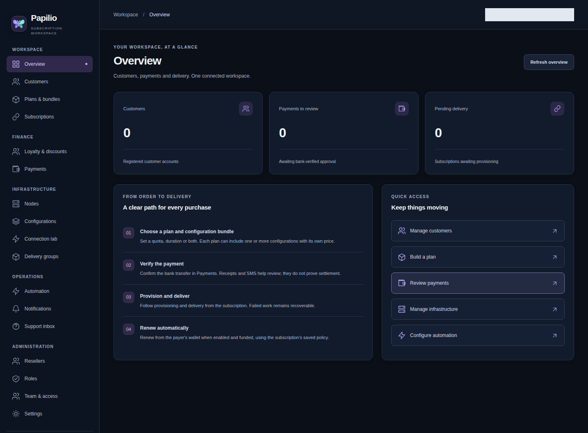
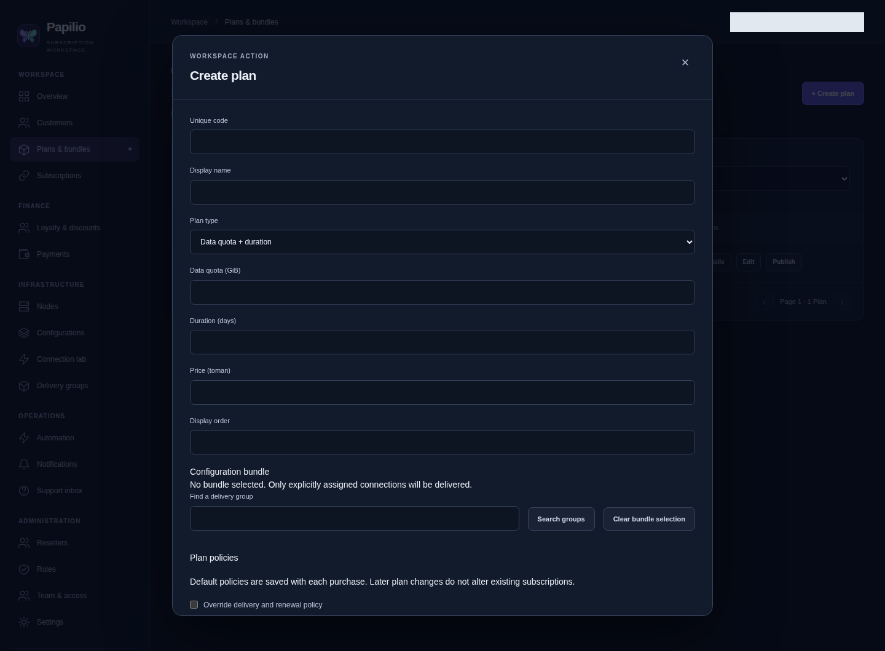
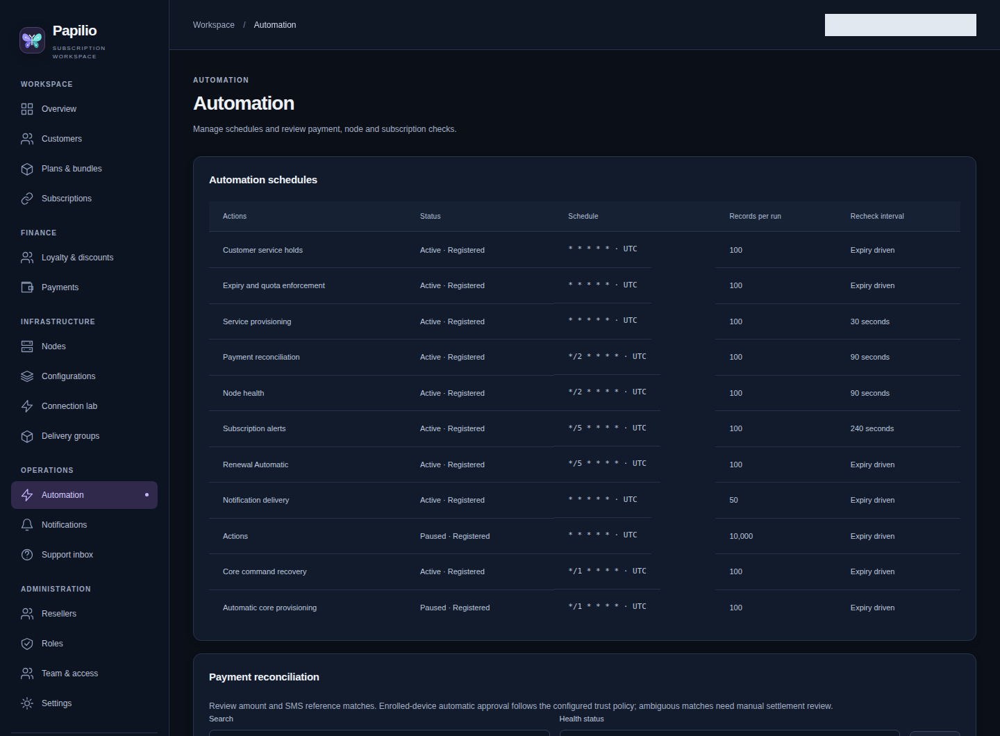
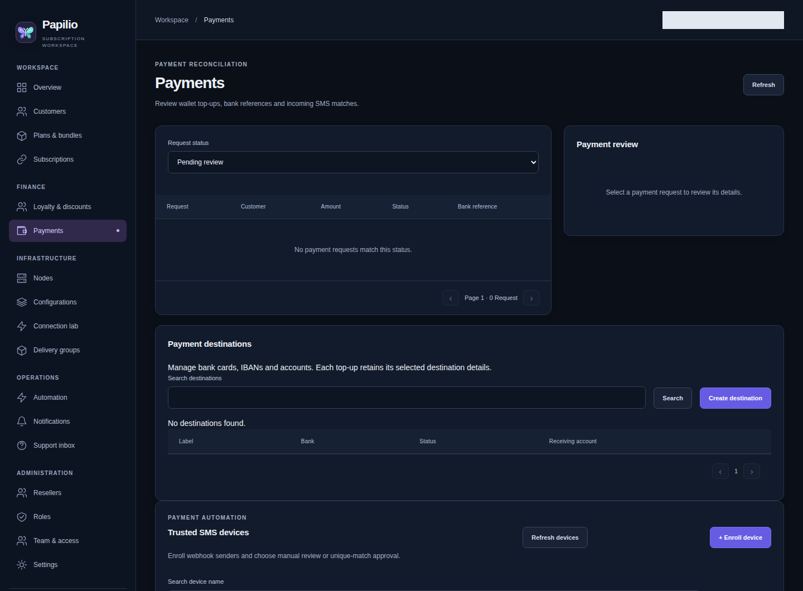
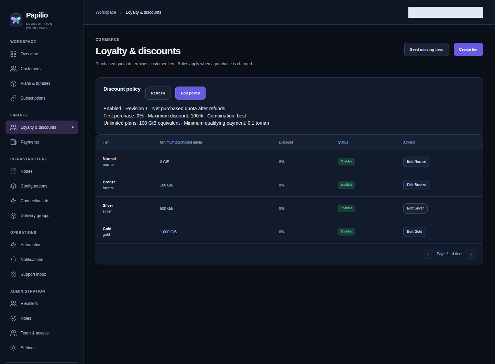
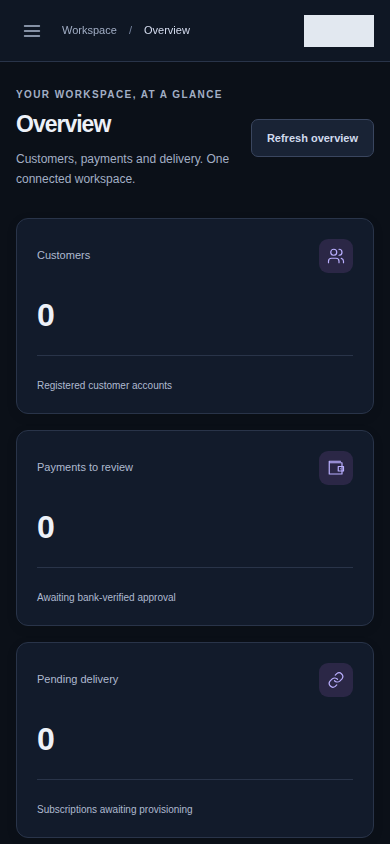

# Papilio Proxy

A configurable subscription control plane for customers, commerce and proxy infrastructure.
Built with **Papilio**, **Papilio Tasks**, **Vue 3**, **aiogram** and **Go**.

**Development preview:** local workflows and bounded core tests are available;
permanent proxy cores remain stopped. Complete protocol enforcement and production
readiness are still open gates.

[Features](#features) · [Screenshots](#screenshots) · [Local setup](#local-setup) ·
[Verification](#verification) · [Known limits](#current-limits)

## Architecture

The project is a from-scratch rebuild with three parts:

| Part | Source | Responsibility |
| --- | --- | --- |
| Panel | `panel/backend`, `panel/frontend` | Papilio API, Papilio Tasks, MySQL, and English Vue administration |
| Telegram | `bot` | aiogram webhook and presentation; business decisions stay in the API |
| Proxy | `proxy` | Go node runtime, quality/IP clients and dormant OpenVPN management adapter |

The Auryx backend/frontend conventions guide the source layout. Old application source has been removed. Historical data has not been migrated into this new schema. Nothing in this rebuild has been deployed to the remote server.

## Features

| Area | Capabilities |
| --- | --- |
| Customers and access | Customer profiles, assigned configurations, separate customer/reseller sessions, staff roles and scoped actions. |
| Plans and bundles | Quota + duration, quota without expiry, or duration with unlimited data; per-plan prices and one or more configurations; immutable purchased terms. |
| Wallet and renewal | Paged credit/debit/refund ledger, wallet checkout, funded opt-in automatic renewal and recoverable provisioning failures with idempotent refunds. |
| Payments | Editable card/IBAN/account destinations, encrypted receipts, manual bank-reference approval, replay protection and an optional four-digit **rial** amount identifier. |
| SMS reconciliation | Enrolled webhook sources, encrypted keys, sender/account/parser rules, rotation and revocation; explicit unique-match approval and manual review for ambiguous evidence. |
| Loyalty and discounts | Editable Normal/Bronze/Silver/Gold tiers, purchased-quota thresholds, unlimited-plan quota equivalents, first-purchase discounts and configurable discount combinations. |
| Automation | Native scheduler → Redis → worker execution for payment review, node health, checkout recovery, renewal and subscription notices; editable schedules and application-owned capacities. |
| Proxy inventory | Nodes, multiple cores/inbounds per node, port reservations, reusable hosts/delivery groups, capability reports and network-specific probe summaries. |
| Configuration editing | Typed saved settings and versioned full Xray/sing-box JSON, managed/experimental modes, private server/client exports and revision history. |
| IP allowance | One/N/unlimited active source IPs shared across assigned configurations/nodes; purchased snapshots, operational overrides, timed bans and pending lease-drain transitions. IP count is not device count. |
| Delivery and operations | Stable revocable subscription URLs, private profile downloads/QRs, provisioning status, notifications, support inbox and reseller workflows. |
| Panel and security | English LTR Vue UI, responsive navigation, creation/edit dialogs, retained failed drafts, searchable paged selectors, CSRF, secure session cookies, Redis login throttling and encrypted recovery. |

Configuration drafts cover **VLESS/REALITY, VLESS/TLS, VMess/TLS, Trojan/TLS,
Shadowsocks 2022, Hysteria 2, WireGuard and OpenVPN**. Export, installation,
connectivity and ongoing enforcement are separate capabilities; see
[core acceptance](proxy/CORE-ACCEPTANCE.md) and [current limits](#current-limits).
The aiogram adapter presents Persian bot workflows; live Telegram and physical
SMS forwarding remain unverified. The native Android prototype is canceled.

## Screenshots

Captured from the actual local Vue panel and Papilio API on **2026-10-09**.
These show the existing workspace, including empty collections, without fabricated
customer/payment data. The plan dialog is an unsaved draft. Operator identity is
masked; no financial or provisioning records were created for the images.
Click an image to open its full resolution.

### Workspace overview

Customer, payment-review and pending-delivery summaries, grouped navigation and
quick access to the purchase lifecycle.

[](assets/screenshots/overview.png)

### Plans and automation

| Plan creation | Native automation schedules |
| --- | --- |
| [](assets/screenshots/plan-builder.png) | [](assets/screenshots/automation.png) |
| Configure plan limits, pricing and the delivery bundle in a modal. | Review schedule registration, enabled/paused state and per-run policy. |

### Payments and customer loyalty

| Payment workspace | Loyalty and discounts |
| --- | --- |
| [](assets/screenshots/payments.png) | [](assets/screenshots/loyalty.png) |
| Review top-ups and manage payment destinations and enrolled SMS senders. | Configure purchased-quota tiers and discount policy; the shown tier discounts are zero. |

<details>
<summary>Mobile workspace</summary>

The same overview at a 390-pixel viewport, with stacked metrics and a navigation drawer.

<a href="assets/screenshots/overview-mobile.png"></a>

</details>

## Selected-plan checkout and purchase notices

Customer and bot checkouts capture a selected plan, its price, connection bundle,
funding method and immutable deadline. Enable `purchase_checkout` in business
settings after configuring private `purchase_intents` capacities. Wallet funding
and an approved linked top-up use the same durable purchase identity. Cancellation
or expiry retains an approved credit in the wallet; a failed provisioned purchase
follows its saved recovery/refund policy and is not automatically bought again.

The purchase policy offers automatic retry until expiry or explicit confirmation
when connection inventory is temporarily busy. A changed plan or price follows
the customer's separate confirmation/cancellation decision. An uncertain client
request retains its original key and body; retiring that key fences a delayed
request before a fresh checkout can be created.

Optional notification templates cover checkout review, cancellation and expiry.
Missing or disabled templates suppress delivery. Messages link to the current
owned checkout, so an older review notice cannot authorize an expired or cancelled
purchase. Readonly settings capabilities declare supported modes and notice kinds;
clients connected to an older API omit unsupported fields.

## Node capability reports

Private `node_capabilities` settings own report byte/history/page capacities and
freshness. The explicit Go `-publish-capabilities` mode submits a durable,
authenticated metadata report without starting a core. Open **Nodes → Capabilities**
for latest status and paginated history. Reported versions and reference digests
are separate from independent installation, connectivity and enforcement proof.
Other engine adapters and strict enforcement remain unavailable where indicated.

Capability receipt submission owns a fresh standalone native transaction;
composed callers must submit after completing their earlier SQL operation.
Current reads and a node owner lock enforce exact replay and configured capacity.
Metadata does not grant runtime startup authority.

## Export a complete core

Open **Nodes → Cores → Export core**. Choose independent files for any core kind,
including WireGuard, OpenVPN and Hysteria, or combined server JSON for Xray and
sing-box. Combined JSON keeps every inbound and deduplicates matching named
outbounds. Different shared settings (including missing versus present DNS or
routing), conflicting outbound definitions and duplicate inbound tags are rejected;
use independent files or align the saved documents. Each artifact includes its
configuration revisions and SHA-256. Exporting does not apply or start a core.

Enable `core_exports` in private backend settings and choose its configuration,
profile and output byte capacities. The existing per-configuration profile capacity
still applies. The API supports full-core export at
`POST /v1/admin/network/cores/{id}/export` and explicit selections at
`POST /v1/admin/network/configurations/server-downloads`. Both require protected
admin access; downloads contain secrets and must be kept private.


## Versioned core runtime

Open **Nodes → Cores → Runtime** to capture an encrypted immutable export,
browse revision and command history, and submit validate/apply/restart/stop or
rollback commands. Reconciliation offers observation without startup, or explicit
restoration of a selected revision. The core list distinguishes the saved desired
and applied revisions from the last acknowledged process observation.

The Papilio API owns eligibility, permissions, command leases, replay and revision
checks. Native Papilio Tasks recovers expired command leases. The Go node runtime
validates Xray/sing-box files with their actual binaries before replacement and
keeps private durable journals. Configure capacities and the startup gate in
`core_runtime`; startup remains disabled in ordinary local configuration.
See [node runtime setup and limits](proxy/RUNTIME.md).

An operator Stop pauses automatic provisioning for that core. An authorized
Apply, Restart, Rollback or Restore resumes it. The panel shows the pause and
dated last acknowledgement; captured membership metadata describes provenance.

Optional `core_provisioning.mode: installed_only` lets native scheduled work
install prepared purchases as immutable full-core revisions. The Go agent must
then separately claim and acknowledge each profile against the exact live
installed membership. A core-process acknowledgement alone cannot activate the
purchase. Both the API policy and the node's `provisioning` mode must opt in;
ordinary configuration keeps this bridge disabled and startup disallowed.
Older revisions without captured membership cannot supply this proof.

This bridge verifies installation for Xray/sing-box. Quota, expiry and source-IP
enforcement have separate gates; `enforced` mode is currently unavailable.
Persistent cores and remote services remain stopped.

## Edit configuration JSON in the panel

Select a node/core configuration and open **Saved settings JSON** to edit its saved `label` and typed `options`. This works for the existing protocol drafts, including OpenVPN and WireGuard. Protocol, port ownership, immutable certificate identity and revision checks still apply. Failed saves retain the draft.

Staff with `network:manage` can open **Full core JSON and history** for Xray and sing-box. Saving/restoring also requires `network:update` and a change reason:

- **Managed:** keep `"inbounds": [{"$papilio": "managed"}]`; customize the remaining root document, including DNS, routing/route and outbounds. The downloaded server document inserts the generated inbound and eligible customer credentials. The marker is a template instruction, not runnable core JSON.
- **Experimental:** edit the entire JSON object. The saved document can be previewed/downloaded, but cannot be assigned to customers. Switching an assigned configuration to this mode is rejected, including concurrent assignment.
- **Recovery:** page through encrypted prior server-document revisions, restore a document against the current revision/capacity, or reset to automatic generation. Restore keeps the current typed options and certificate/key material. Preview is the saved export; save a draft before previewing it.

`configuration_json` in private application configuration owns enablement, UTF-8 document size and nesting limits. Missing/disabled policy blocks new documents; reset remains available. JSON parsing/encryption run in a standard worker thread, and browser formatting runs in a Web Worker. Duplicate fields, non-finite numbers, invalid roots, excess capacity and a missing managed marker are rejected by the API. Private server documents are excluded from ordinary network reads. Configuration/history/provisioning ciphertext uses MySQL `LONGTEXT`; document capacities still apply independently.

These are offline drafts. Arbitrary core fields are not validated against an installed core version, and a valid JSON document does not establish routing safety, working transport, quota enforcement or connectivity. OpenVPN/WireGuard use their typed settings JSON and native file exports. No core is started by either editor.

## Local setup

Use Python 3.13+, MySQL 8, Redis, Go, and pnpm. Create an isolated local database and Redis instance, then install `panel/backend` from its `pyproject.toml`. The bootstrap script reads the following environment variables only when it first creates the ignored private `panel/backend/config.yml`:

```text
PAPILIO_LOCAL_DB_DSN
PAPILIO_LOCAL_REDIS_URL
PAPILIO_LOCAL_ADMIN_ORIGIN
PAPILIO_LOCAL_SUB_ORIGIN
PAPILIO_LOCAL_OWNER_USERNAME
PAPILIO_LOCAL_ADDITIONAL_ADMIN_ORIGINS  # optional comma-separated origin allowlist
```

Run `python scripts/bootstrap_local.py` from `panel/backend` to apply Alembic migrations and create the local owner. Its generated credentials are stored privately at `data/local-admin-credentials`. Keep `crypto.encryption_key` and `crypto.password_salt` with the encrypted database backup; losing them makes stored credentials unrecoverable. Review `panel/backend/config.yml.sample` for operational policy, including page sizes, automation batch sizes/crons/retries, payment review windows, node report freshness, expiry warnings, payment instructions, quality thresholds, and IP-limit defaults/ceilings. Existing private configurations need the `ip_limits` section, `public.brand_title`, and the current operational settings; bootstrap fills missing sample settings while preserving existing values. Reseller and OpenVPN draft settings are included; `PAPILIO_LOCAL_RESELLER_ORIGIN` can select a separate local reseller origin. New purchases snapshot the plan’s IP override or enabled business default; policies already saved on subscriptions are retained.

### Plan limits

The English plan editor offers quota with duration, quota without expiry, and unlimited data with duration. The API represents no volume limit as `quota_bytes: null` and no time limit as `duration_days: null`; a plan must have at least one limit. Zero is invalid. Purchased limits remain unchanged when the catalog is edited. Quota-only auto-renewal needs the quota/either trigger in its fulfillment policy; unlimited-volume plans still record consumption and use bounded accounting grants. Migration `0037_plan_limits` preserves existing values and refuses downgrade when nullable limits would be lost.

Start the local services from `panel/backend`:

```bash
uvicorn src.apps.api:app --host 127.0.0.1 --port 8018 --no-access-log
taskiq worker src.apps.scheduler:broker --workers 1 --max-async-tasks 8
taskiq scheduler src.apps.scheduler:scheduler --skip-first-run --update-interval 15
```

For the panel, copy `panel/frontend/apps/panel/.env.example` to `.env.local`, set the backend URL and local port, then run `pnpm install` and `pnpm --filter @papilio/panel dev` from `panel/frontend`. The sample opens at `http://127.0.0.1:4417/`. The API health endpoint is `/healthz`.

The Telegram bot requires a real bot token, webhook secret/public URL, and the API bot key in its private environment. Its code is present but it is not running locally without those values. The proxy probe requires a registered node and private agent key. No Xray, Hysteria, or WireGuard process is started by this setup.

The bot adapter's operational budgets are explicit in [bot/.env.example](bot/.env.example):
`PAPILIO_API_MAX_RESPONSE_BYTES`, `PAPILIO_API_MAX_CONNECTIONS`,
`PAPILIO_API_READ_BUFFER_BYTES`, keepalive/DNS lifetimes,
`BOT_WEBHOOK_MAX_INFLIGHT`, `BOT_WEBHOOK_MAX_REQUEST_BYTES` and
`BOT_WEBHOOK_PROCESSING_TIMEOUT_SECONDS`. The read buffer must fit within the
response budget. API responses must use identity encoding; redirects are rejected.
Webhook capacity/deadline failures return503 for upstream retry; oversized requests
return413. Business writes must retain their API idempotency keys across retries.
Notification delivery retains its separate request and lease budgets.

## Loyalty and purchase prices

**Commerce → Loyalty & discounts** lists editable customer tiers and opens modal
forms for thresholds, discounts and revisioned rules. **Seed missing tiers** uses
the configured initial tiers and preserves existing edits. Operational tier and
per-plan override capacities live in private `loyalty` configuration; absence leaves
loyalty unavailable. Disable the policy to pause discounts without erasing history.

Policies choose net or lifetime purchased quota, unlimited-plan equivalent or
excluded quota, first-purchase eligibility, best/additive/sequential discount
combination, total discount cap and renewal tier discounts. The customer quote API
returns the effective price before charging; purchase accepts that expected price
and rejects a changed quote. Completed purchases and renewal generations preserve
their price snapshots; the first-purchase discount is excluded from renewal.
Wallet refunds reverse the corresponding quota credit once. Existing historical
purchases count toward first-purchase eligibility without inventing past quota.

The customer panel and Telegram bot show the customer's tier, qualifying purchased
quota and next-tier progress. Purchase choices use the API's authoritative quote,
including the final wallet charge and renewal price. A failed quote blocks purchase;
retrying an uncertain purchase preserves its original purchase key. Tier changes
and applied discounts can produce configurable notification templates through the
existing notification queue and bot delivery bridge.

## Core, host and settings administration

Open **Nodes → Cores → Configurations** to register a core and create its encrypted inbound drafts. Each inbound owns its protocol and listening port. The legacy node protocol/port remain compatibility defaults; an explicit core/inbound can use another supported protocol/port. A reserved TCP or UDP port cannot be assigned twice on one node. Per-configuration downloads export individual inbound drafts; use **Export core** for an explicit combined Xray/sing-box export. Neither download starts a core.

Sing-box supports the existing REALITY, VLESS/VMess/Trojan TLS, Shadowsocks and Hysteria 2 inbound models. The API returns each core's supported protocols; the panel retains the selected core while loading, offers explicit read retry, and shows its supported choices. Server downloads use the selected core's exporter. Node claims identify both core ID and kind. Existing client credentials, revocable URLs, purchased fulfillment policy, export capacities and node socket reservations are retained.

Sing-box exports use the documented [TLS/REALITY format](https://sing-box.sagernet.org/configuration/shared/tls/) and [V2Ray transport fields](https://sing-box.sagernet.org/configuration/shared/v2ray-transport/). TCP omits a V2Ray transport object; WebSocket/gRPC retain their configured path/service name. gRPC requires an appropriate Sing-box build. [Hysteria 2 compatibility](https://sing-box.sagernet.org/configuration/inbound/hysteria2/) uses the combined username/password as its authentication password. Draft generation is available locally. [Real core acceptance](proxy/CORE-ACCEPTANCE.md) verifies the listed exports with temporary TLS files and local traffic. Production installation, accounting and enforcement still require the node adapters.

From an inbound's management view, add its public hosts. Open **Delivery groups**, select a group and search all hosts to add a membership or edit its overrides. Empty override fields inherit the host values. Removing a membership affects only that group. REALITY SNI overrides must match the inbound. TLS certificate coverage and actual endpoint reachability still require testing.

In **Plans & bundles**, choose a delivery group using the paged searchable picker. A disabled group rejects new purchases. Existing subscriptions retain their purchased group even after a plan changes. Group/host/membership availability filters subsequent subscription refreshes; it does not disconnect existing proxy connections. Purchases create a durable provisioning request in the wallet-debit transaction. Automatic preparation selects enabled group inbounds, creates profiles and queues node work; manual policy waits for **Prepare node tasks** in the subscription. Activation waits for authenticated node acknowledgements under the purchased all/any/quorum policy. Draft exports alone do not activate a subscription.

Open **Settings** to edit business settings and review saved versions. Writes require `settings:update`, reads/history require `settings:read`; navigation follows staff scopes. Concurrent edits return a conflict and retain form input until you explicitly reload the current version. Amounts are entered in toman and stored as integer rial. The branding endpoint exposes only the title to authenticated staff. IP defaults populate new policy forms and do not rewrite existing subscription policies.

Migrations `0014_network_foundations` through `0036_openvpn_management_sockets` preserve the prior rebuilt schema (`0013`) and its data. Every listening transport is reserved atomically; Shadowsocks reserves both TCP and UDP. The upgrade stops before changing the schema if older drafts already overlap. The initial network expansion requires a backup for rollback; later schema downgrades can remove new records and are not a substitute for a tested restore. This is separate from migration of historical application data.

## OpenVPN drafts and integration boundaries

Create an OpenVPN node/core, then select its inbound configuration form. Explicitly choose UDP/TCP, routed TUN or TAP with an existing bridge and address pool, key type, modern data ciphers, TLS/control-channel encryption, routes/DNS, lifetimes, keepalive, client capacity and a private Unix management socket. `openvpn` in private application configuration supplies draft availability, allowed key types and operational ceilings; absent/disabled configuration rejects creation. These options describe drafts against the [OpenVPN 2.6 manual](https://openvpn.net/community-docs/community-articles/openvpn-2-6-manual.html); IPv4 address pools are currently supported. TAP additionally needs host bridge/network setup.

Assign profiles through the existing purchase/provisioning workflow. Protected client downloads produce `.ovpn`; server download requires `network:manage`. Expired certificates fail with a recoverable conflict. Node claims omit authority and client private keys. OpenVPN and WireGuard are file exports and are excluded from URI subscription feeds. Public file delivery still requires the correct enabled host and an active, unexpired entitlement. Separate inbounds require independent management sockets on their node; native constraints reject collisions, including normalized path aliases.

The server draft requires a held management connection and certificate-based admission. `proxy/internal/openvpn` consumes bounded [management notifications](https://openvpn.net/community-docs/management-interface.html), checks installed certificate bindings and renewable native IP leases, and emits immediate disconnect commands on denial. Its caller supplies installed acknowledgements, connection ownership, limits/timeouts and a durable usage recorder; missing accounting stops startup. No runtime command wires this adapter to a proxy core. Management sockets have node-owned, case-sensitive native reservations. The Linux listener requires a directory owned by the agent with mode0700, a mode0600 socket and an explicit expected kernel peer UID. [Local core/client tests](proxy/CORE-ACCEPTANCE.md) now pass for UDP/TCP with TUN/TAP. Production counter journals, core installation/application and certificate renewal/rotation history remain open. Creating or downloading a draft does not activate a service.

## Staff and customer administration

Open **Team & access** to search staff, read current grants, create an account, edit its access or reset its password. Each operation requires its own `staff` capability. A delegated manager can grant only capabilities they hold and cannot alter an account above their authority. Concurrent removal or deactivation cannot remove the last active staff member with full access. Access updates require the selected account's original state; stale edits retain form input until you reload. Passwords require at least eight characters. Password reset and deactivation invalidate all existing sessions; authentication locks the account through password verification and session creation to serialize a concurrent reset.

Staff grant capacity is set by `operations.max_staff_grants`; search/paging capacities stay in the owning application settings. From a selected customer, edit their display name, open their wallet or open their subscriptions with the same customer ID. Telegram identity is retained by profile editing. Reseller tenancy remains separate roadmap work.

## Named staff roles

Open **Roles** to search roles, edit grants/activation with a reason and expected revision, page through immutable history, or open an assigned staff record. On that staff record, add, remove or replace role membership; search and paging preserve selections. Refreshing after a conflict preserves the draft. Read-only staff cannot submit changes.

Effective permissions combine direct grants with active roles and are read again on each API request. Disabling a role preserves membership while removing its authority; reactivation restores that authority. Previously accepted requests are not cancelled. Global owner authority requires a direct grant and cannot be stored in a shared role. Delegated editors cannot exceed their current authority or edit a role belonging to a more privileged account. Role changes do not reset passwords or erase existing direct permissions.

Owning capacities are `operations.max_staff_grants`, `max_staff_roles` and `max_staff_role_members`. `staff_inactive_role_assignment` explicitly permits or rejects newly assigning inactive roles. Tightened capacities retain existing records; membership replacement/removal can reduce them. The direct owner can correct a role whose member count exceeds a tightened delegation-review limit. These roles are staff authorization, not reseller data isolation.

## Free trials

**Settings → Trial policy** selects a searchable, paged source plan and configures availability, eligibility (no prior paid purchase/any customer), concurrent trials (reject active/allow multiple), per-account claim limit, cooldown, quota and duration. Source network/group/IP policies are snapshotted; the source plan price is never charged. Private `trials` configuration owns the operational ceilings. Trials are initially disabled and require an active source plan before claims can succeed.

The selected customer record and the customer account's **Purchase service** expose the same API-owned eligibility/claim workflow. The thin bot has an **Trial subscription** action. Accepted replay keys retain the original trial after policy changes; simultaneous claims cannot exceed the account cap. Failed requests retain their key. Trials use normal acknowledged provisioning, private delivery, quota/expiry revocation and recovery, and cannot enable automatic renewal. An uncharged failed trial creates no wallet credit. Accepted claims, including finalized failures, count toward the configured cap; operator provisioning recovery or an explicit policy change is required for another attempt. Per-account limits do not establish resistance to multiple Telegram accounts.

## Customer notifications and delivery

Open **Notifications** from navigation or a customer record. Search/paging keeps the actual customer and selected notice. Scoped staff can create a notice from the configured manual template or supply both title and body, inspect delivery attempts, explicitly dispatch one notice, and retry/cancel an eligible record with a reason and expected revision. A stale write retains the draft; refresh updates its revision. Read-only staff can inspect records and paged history. Customers open **My notifications**, filter their own inbox, mark one notice read/unread and open its actual support, payment or subscription record. Inbox responses omit staff identities and lease credentials.

**Settings** configures recording, new-notice channels (inbox/Telegram/both), delivery pause, per-kind templates/activation, fixed/exponential retry timing, attempt budgets and ambiguous-outcome hold/retry. Manual templates are static defaults and can be overridden. Automatic templates accept `{id}`, `{amount_toman}` and `{status}`; rial conversion is exact. Private `notifications` configuration owns capacities, deadlines, response/request size budgets and the authenticated adapter connection. Long inbox-only messages and Telegram's protocol length boundary are distinct. Tightened capacities pause expansion without erasing existing records. Safe retries retain the accepted event's snapshot across later policy changes.

Payment approval, staff support replies, provisioning activation and expiry/funding/failure attention checks record durable notices inside their owning transaction. Native Papilio Tasks scans dispatch eligible records; disabled delivery avoids expanding paused work while expired leases remain recoverable. Attempts use a monotonic history and a separate budget reset by audited operator recovery. A failed paid operation remains governed by its original payment/provisioning recovery rules.

The API leases a delivery, the thin aiogram bridge obtains a one-use API authorization and sends plain text, and the API records the outcome. Repeating a lease cannot authorize a second send. A transport timeout or expired lease remains ambiguous; configured retry or manual retry may duplicate an earlier message. This is not exactly-once Telegram delivery. A provider-requested retry delay exceeding the configured ceiling stops for operator correction rather than retrying early. Cancellation cannot undo an already sent message.

Local private configuration keeps outbound delivery disabled; the Telegram adapter is not started. A future adapter requires its separate delivery key and explicit `NOTIFICATION_*` settings in [bot/.env.example](bot/.env.example). The API and bridge must use compatible request, timeout, lease and response budgets. Do not place subscription credentials in notification templates. Live Telegram/provider reachability and production delivery are separate acceptance gates.

### Subscription alerts and renewal readiness

The subscription alert settings support named low-quota rules using remaining
bytes, remaining percentage in basis points, or both with `any`/`all` matching.
Expiry rules use hours; renewal opportunities use the owned subscription quote.
Unlimited-data plans skip quota rules; plans without expiry skip expiry rules.
A null or disabled policy retains the earlier attention notification behavior.
Application configuration bounds rule counts and expiry ranges.

An accepted alert preserves its first quota, usage, expiry and price context.
Replay keys include subscription, renewal generation and stable rule identity.
Alert templates additionally support `{quota_gib}`, `{used_gib}`,
`{remaining_gib}`, `{expires_at}`, `{renewal_price_toman}`, `{generation}` and
`{threshold_code}`. Removing an optional template pauses eligible work; restoring
it permits recovery without discarding the accepted notice.

Customer service details and the bot expose renewal quote availability, due
state, authorization and wallet funding separately. Another payer's wallet
balance and shortfall are private. Viewing readiness does not execute a renewal.
These contracts require migration `0047_subscription_notice_context`.
Apply the current migrations before restarting the API, worker and scheduler;
use the recovery CLI to create and verify an encrypted backup first.

## Support tickets

Customers open **Support** from their account, subscription or payment; staff open it from a customer or related record. The known customer and optional source stay attached to creation. Search, status filters, messages and immutable history are paged. Staff need `support:read` to view, `support:create` to create for a known customer and `support:update` to reply or change status. Customer cookies remain separate from staff cookies, and customer reads expose no internal staff IDs.

In **Settings**, configure new tickets, customer/staff replies, customer closure/manual reopening, the status after staff replies, and whether replying to a closed ticket rejects or reopens it. Configure open-ticket, message and character limits within private `support` capacities. Tightening a capacity preserves existing threads and allows closure while blocking new expansion until corrected. Unicode character counting matches the API; failed or stale writes retain drafts, and explicit refresh updates the revision without discarding input. Replay keys prevent duplicate creation/messages.

The bot support action requests a one-use customer login link from the Papilio API. If customer login is disabled, the API returns the configured support contact or explicit unavailability. The aiogram adapter remains thin. This workflow supports text only; attachments, SLA reminders, automatic closure and actual Telegram notification delivery are not implemented or exercised.

## Editable automation schedules

In **Automation**, select a schedule to edit its enabled state, cron/time zone or fixed interval, batch size and recheck interval. Changes require settings-update permission and access to the owning section. Revisions detect conflicting edits; failed drafts remain available for review, and history is paged.

MySQL retains the desired policy and audit history. Native Papilio Tasks registers it in Redis, restores missing registrations at worker startup and during periodic reconciliation, and carries native retry labels. The panel distinguishes saved policies from registered revisions and offers explicit reconciliation. Paused or obsolete queued scans decline new work; previously accepted individual checks may finish. Operational capacities live in the owning application configuration; a saved policy exceeding tightened capacities is visibly blocked until corrected. Native queue delivery remains at least once, with financial effects protected by their existing transaction/replay invariants.

Initial modes/cadences, registration cron/prefix, interval bounds, batch/recheck ceilings and retries are supplied by `operations.automation_*` configuration. Existing registered policies remain versioned rather than silently changing with new defaults.

## Independent customer access

The selected customer’s **Customer access** separates login, service access and automatic renewal. Disabling login revokes existing sessions and one-use links while preserving paid service access. Disabling renewal prevents scheduled renewal debits. Disabling service access blocks new purchases, configuration delivery, IP admission and usage grants immediately at the API boundary; native scheduler/worker jobs revoke active or pending provisioning on every target and retain final usage reports. Physical enforcement still depends on node acknowledgements.

Choose an explicit continue/pause clock when stopping services. A quick re-enable preserves the pending stop until every revocation completes; subscriptions stay suspended until explicitly resumed. A never-activated purchase can resume and allocate its first profiles without another wallet charge. Changes retain actor/reason/history and bind retry keys to the original request. Stale edits preserve choices for review.

New account defaults live in versioned **Settings** (`customer_creation_access`), falling back to private `customers.creation_access`. Admin creation supports an explicit override; new Telegram identities use the owning application policy without changing existing identities. `operations.customer_hold_scan_cron` and `customer_hold_batch_size` control scans. Unfinished finalization rotates through the batch so one unavailable node cannot starve later customers.

## Provisioning, customer delivery and usage

In **Plans & bundles**, inherit business defaults or set per-plan delivery, renewal, quota and IP policies. They are saved with a purchase; later plan/default edits do not change that purchase. Renewal supports expiry/quota/either triggers, purchased/current-plan pricing and reset/carry-unused quota. In **Subscriptions**, select a record to inspect node tasks, prepare manually, retry with a reason, check expiry/quota, and view usage. A retry retains the paid generation and does not debit again. An inbound edit increments its revision; its old acknowledgement cannot publish a changed profile.

For an active subscription, **Suspend and resume service** accepts a reason and an explicit expiry policy: continue counting time or pause it. Delivery closes as revocation begins; physical revocation still needs every node's acknowledgement and final usage report. Resumption requires completed revocation and remaining time/quota. It reapplies the same profiles without changing the subscription URL, renewing the generation or debiting the wallet. Its failure remains recoverable; the original purchase cannot be refunded through provisioning failure once service has been activated. Request keys bind the operation and inputs, so old retries cannot repeat a later suspension or add paused time twice. The record retains a paged history with actor, reason, time and clock choice.

Agents authenticate with `X-Papilio-Node-Key` under `/v1/nodes/{code}/provisioning`. They page tasks, claim individual work and acknowledge applied/failed/revoked outcomes using the current private claim token. Claims include generation, inbound revision, encrypted-at-rest settings/credentials, expiry and quota policy. Keep access logs disabled; task metadata never includes credentials. Revoke work remains available on disabled nodes. The agent must serialize changes to a profile, honor claim versions and stop traffic before final usage/revocation; the API acknowledgement alone is not proof of a tested core adapter.

Customers open `/service/{token}` on the configured `public.customer_portal_origin`, separate from the feed origin. It shows this subscription’s status and paged ready profiles, including WireGuard `.conf`. `/s/{token}/status`, `/profiles`, and individual `/profiles/{id}/download` enforce token ownership. Bot-owned delivery/link-rotation API actions also verify customer ownership. Changing a token invalidates its previous URL. These pages are not customer account or wallet authentication.

Nodes allocate usage grants at `POST /v1/nodes/{code}/usage/grants`, then report cumulative upload/download counters at `/grants/{id}/reports`. Each grant owns a counter epoch; reset counters require a final report and a new allocation. Reports carry an event ID, increasing sequence, aware sample time and final flag. Replays have no extra accounting effect; changed replays, decreasing counters and wrong ownership are rejected. Accepted deltas are persisted and summed across every node of the current generation. Historic reports cannot charge a newer generation.

`reported` mode relies on timely node reports and can overshoot while reports are delayed. `reserved` mode shares the remaining quota across node grants; consumed plus open reserved bytes cannot be allocated again. Nodes must enforce byte and time budgets. Expiry of a grant does not release its uncertain remainder; final usage confirmation closes it. Actual consumption exceeding a budget remains recorded and is shown as a budget violation; further allocation is refused once no global quota remains. Renewal waits for final reports and all old-generation revocations before another debit. There is no claim of live strict enforcement while adapters and cores are stopped.

**Overview** summarizes customers, pending payment reviews and pending delivery; subscription records retain their own usage context. Admin usage/grant lists are paged, and summaries cover the entire requested range. The API uses UTC; displayed report dates use the configured panel timezone and English calendar. Business quota defaults are versioned in settings; operational ceilings, scheduler crons and batch capacities are private configuration.

## Private connection QR images

The customer's **Configuration downloads** page offers a QR image for the stable subscription link and each ready profile, retaining the selected host. The image contains the same URL or client configuration as the ordinary download; it is a private credential. Customers can view, close or download the PNG. Link/file delivery remains available when QR rendering is disabled or the configuration exceeds rendering capacity. Scanner support for individual configuration formats varies by client.

Versioned **Connection QR code** settings control activation, error correction, pixel size and white border. Private `qr_codes` configuration sets maximum box/border size, image dimensions, payload bytes and PNG bytes. Omitting the section disables QR generation; older preference records inherit configured defaults. After capacity tightening, disable the policy or reduce its dimensions to recover. The four-module white margin is a QR protocol requirement. Rendering uses [python-qrcode](https://github.com/lincolnloop/python-qrcode) in a standard worker thread; Papilio continues to own access, configuration and errors.

`GET /s/{token}/qr` renders the subscription URL only when ready feed delivery exists. `GET /s/{token}/profiles/{profile_id}/qr?host_id={host_id}` renders an owned ready profile. Existing entitlement, hold, expiry, acknowledgement and token-rotation rules apply. Successful images have no-store, no-referrer and nosniff headers; image filenames contain no identifiers or credentials. No proxy core or Telegram runtime is needed to render images.

## IP admission contract

Nodes call `POST /v1/nodes/{code}/ip-admission` with their private `X-Papilio-Node-Key` and `{subscription_id, source_ip}`. The response identifies the same subscription/IP, whether it is allowed, its reason, and the lease deadline. Existing IPs share one slot across assigned nodes. Rejected requests do not extend a timed ban. Expired leases free capacity during admission; a cleanup scheduler is not required for enforcement decisions. Manual unban frees a restriction without reserving capacity.

Plans explicitly support one active source IP, at most N, or unlimited. Purchased
terms are immutable and separate from an operational override. Increasing an
enabled limit retains existing presence. Tightening uses `drain_leases`: new
admissions and renewals pause until the latest actually issued lease expires.
Successful unlimited admissions also record that deadline. Legacy unknown lease
history is blocked; `require_closed_receipts` is unavailable until native receipt
authority exists. The panel displays purchased, current and requested policies
separately, with pending reasons and retry times. Source IP count is not device count.

`proxy/ipadmission` provides the verified-HTTPS client and connection guard. A protocol adapter must call `Guard.Protect` before proxy traffic starts, close the returned owner when the connection ends, and supply its own request/response budgets and renewal lead time. The guard renews before the lease deadline and closes its connection on denied renewal, expiry, cancellation or API failure. Its transport accepts plain HTTP only on an explicit loopback IP, does not follow redirects and avoids secrets in errors. Policy changes and oldest-IP replacement take effect on existing connections at their next lease check; immediate cross-node disconnect is not promised. Native API admission and drain have passed isolated two-node managed-Xray gates, with two unexplained transient failures still open. Safe replacement without temporary overlap, Hysteria/WireGuard integration and native quota authority remain open.

## Encrypted database recovery

Run `scripts/recovery.py` from `panel/backend`. Copy `recovery.yml.sample` to a private operational configuration and set client executables, timeouts, streaming chunk size, SQL/payload/archive capacities and temporary directory. `online` uses an InnoDB transactional snapshot; `locked` takes MySQL's server-wide read lock during the dump. Keep migrations stopped during either mode. Views, triggers, routines, events and non-InnoDB tables are rejected.

Use an independent recovery key containing at least 32 characters, stored in a file readable only by its owner. Keep that key separately from the backup host. The authenticated encrypted archive contains the SQL snapshot and original private application configuration, including the crypto/password material required to recover stored credentials and images. Archive and extracted configuration files are created with mode `0600` and never overwrite existing paths.

```bash
python scripts/recovery.py --recovery-config recovery.yml --key-file /secure/recovery.key create --app-config config.yml --output /secure/papilio.encrypted
python scripts/recovery.py --recovery-config recovery.yml --key-file /secure/recovery.key verify --archive /secure/papilio.encrypted
python scripts/recovery.py --recovery-config recovery.yml --key-file /secure/recovery.key restore --archive /secure/papilio.encrypted --target-config recovery-target.yml
python scripts/recovery.py --recovery-config recovery.yml --key-file /secure/recovery.key extract-config --archive /secure/papilio.encrypted --output /secure/recovered-config.yml
```

Create an empty target database and its private configuration first; do not run an application or other writers against it while restoring. Restore checks authentication, SQL integrity, configured capacities, target emptiness and schema revision. A failed SQL import may leave partial tables; it does not drop them or replace an existing database. Retry into a fresh empty target. Temporary plaintext SQL/client files remain inside a private temporary directory and are removed on normal completion or failure. Choose storage suitable for private recovery data.

Before starting a recovered application, review its database/Redis destinations, origins and outbound integrations, apply required migrations, then verify login, private downloads, financial replay and provisioning recovery. Copying an archive to independent storage and testing recovery on the selected infrastructure are operational steps; the CLI does not start a bot, worker, core or remote service. Earlier local backup files used a different payload format and are not inputs to this versioned tool.

## Verification

Run `ruff check src tests scripts migrations`, `ruff format --check src tests scripts migrations`, `pyright --pythonpath ../../.venv/bin/python src tests scripts`, and `pytest -q` from `panel/backend`; integration tests require `PAPILIO_TEST_DATABASE_URL` pointing to a disposable MySQL database and `PAPILIO_TEST_REDIS_URL` pointing to isolated Redis. The scheduler workflow starts native worker/beat subprocesses and waits up to 90 seconds for committed outcomes, then removes its own Redis namespace. Run `pnpm --filter @papilio/panel build` from `panel/frontend`, and `go test ./...` plus `go vet ./...` from `proxy`.

## Customer accounts and payment review

`/account` is a customer account separate from `/service/:token` delivery. The trusted aiogram bot calls `POST /v1/bot/account-link` to issue a short one-use login URL. The token is in the URL fragment, is exchanged through a request body, and is removed from browser history. The subscription token never authorizes wallet/payment operations. Customer sessions use separate HTTP-only cookies and CSRF tokens; every customer financial operation derives the customer identity from that session. Disabled customers cannot exchange or use sessions.

The customer account provides wallet balance and paged ledger/top-ups, searchable paged payment destinations and active plans, wallet purchase, owned service status, renewal choice and permitted link rotation. Failed requests retain input and idempotency keys. New customer purchases must confirm the displayed rial price. A changed price rejects the purchase before any debit; the UI refreshes the same selected plan for confirmation. Stable purchase-key replays return the existing owned purchase before evaluating current plan prices, including after renewal. The bot displays active plan price/duration and embeds its confirmed price in purchase callbacks. Successful purchases await the durable provisioning workflow; viewing the account does not start a proxy core.

From **Payments**, create/edit/disable card, Iranian IBAN or bank-account destinations and inspect a selected payment's instructions/receipts. Destination details and per-top-up instruction snapshots are encrypted. Changes to a destination affect future requests. Checkout policy supports required destination selection, optional selection and legacy text instructions, permitted methods and rial amount limits. Legacy top-ups retain their original settlement records and may have no destination snapshot. Card/IBAN validation checks format, not bank-account ownership or settlement.

Receipt uploads validate bounded JPEG/PNG/WebP images and re-encode pixels without EXIF or appended payloads. Encrypted image data resides in a separate MySQL table, within the database transaction and backup boundary; paged metadata defers image payload loading. Download requires the owning customer or scoped staff session. Repeated content is idempotent; new receipts are allowed for pending payments within the configured limit. A payment row lock and current count protect that limit against concurrent authenticated snapshots. Receipt/OCR output cannot settle a payment. Manual bank-reference confirmation credits the wallet once; explicitly enrolled sources may also settle through the owner-approved unique SMS mode. Enrollment authenticates the source, not the bank itself.

Versioned panel settings control receipt availability, image formats and per-payment receipt count. The owning `checkout`, `receipts` and `customer_auth` private configuration sections set operational ceilings, image byte/pixel/processing capacities, login/session lifetime and portal availability. Busy image processing returns a retryable error and retains the selected file. Receipt ciphertext increases database/backup size; encrypted backup decryption alone does not prove disaster recovery or an off-node restore.


## Four-digit payment amounts and SMS enrollment

The identifier is exactly the final four digits of the **RIAL payable amount**,
including leading zeroes. For example, a requested1,050,000Rial with assigned
identifier1234 requires1,051,234Rial. The whole1,051,234Rial credits the wallet;
the1,234Rial adjustment is customer credit, not a fee. The selected plan price is
charged separately. Always transfer the captured payable amount, not a rounded
Toman display or the original request. Retries preserve the original invoice.

In **Settings → Checkout policy**, set an explicit payment identifier policy and
choose exact requested amount or four-digit RIAL suffix. The private
`checkout.payment_identifier_capacity` sets ceilings; panel policy chooses the
permitted upward adjustment and amount step. Use step10 for a sender that accepts
only integer Toman; step1 is appropriate only when exact RIAL entry is supported.
A larger step reduces available suffixes. Exhaustion is a conflict requiring
operator review, not permission to reuse a pending code. These allocation restrictions
apply only to the four-digit method. Disabled or exact-requested mode leaves the
requested amount unchanged, allows repeated amounts/suffixes and creates no code
reservation. Existing invoices retain their captured amounts/codes and replay
protection when the method is changed. Four-digit allocation still checks issued
full-amount history to protect that method against delayed payments.

In **Payments → SMS source rules**, configure a literal parser profile, receiving
realm and account aliases, then bind the actual payment destination and enrolled
source. These are account records, not sample accounts. `sms_origins` in the
private application configuration owns management availability, paging, parser,
message, matching and original timestamp ceilings. The sample keeps it disabled.
No receiving account, sender or bank parser is created automatically.

The webhook sender must retain the original SMS sender, original provider
millisecond timestamp and message content, and declare canonicalization revision1.
New forwarding timestamps cannot replace the original timestamp. Only declared
`direct_sms` observations are eligible for trusted-origin automatic matching;
forwarded/imported/manual observations remain reviewable. Device authentication
proves possession of the enrolled source key; it is not independent bank or OS
attestation. The default identity mode requires a bank reference. Select
`trusted_origin_fingerprint` explicitly for an enrolled no-reference format.
Withdrawal, balance-only, conflicting/multiple candidates, stale enrollment and
unresolved receiving-account identity cannot automatically credit a wallet.

Open ambiguous SMS from its review record, inspect the full amount/account and
select an eligible invoice with the current revision. One observation and one
settlement identity can credit only one invoice; replay does not credit again.
The four-digit suffix alone never proves settlement. Native payment-review
scheduler/worker recovery can retry previously received observations when their
invoice becomes available; actual physical forwarding still needs enrollment.

## Current limits

Purchases remain `pending_provision` until their node work is independently acknowledged. The native Papilio Tasks → Go agent → actual Xray/sing-box installation and paid-purchase delivery paths have passed isolated local integration tests. Runtime ACK alone cannot activate a purchase. Usage observation, quota enforcement, expiry and source-IP admission have separate acceptance gates; `enforced` mode remains unavailable. Ordinary startup and automatic core provisioning remain disabled.

The bounded first Xray usage slice passed an isolated native two-core workflow: payment and installation, actual traffic and counters, accounting replay, and subscriber isolation from Stats APIs. Its configured Stats ports are reserved across managed cores on the same node, and managed runtime exports restrict custom egress to the validated isolation policy. Configuration availability in the panel does not prove an observed process or connectivity. Continuous grant renewal, safe changes to a shared core with active customers, and adapters for other engines remain open.

WireGuard profiles download as `.conf`; the URI feed excludes file-only WireGuard and OpenVPN. No subscription is activated merely by exporting a file. Failed provisioning can wait for operator recovery or request revocation followed by exactly one wallet refund; an unreachable node keeps revocation pending. Expiry or exhausted quota does not refund consumed service.

Native automation schedules include payment review, node status, checkout recovery, subscription attention and renewal. Payment approval credits the wallet once. Unique SMS mode trusts an enrolled phone under the owner-approved policy and sends ambiguous matches to review; it does not independently verify bank settlement. An approved top-up can fund a durable selected-plan checkout under the configured policy. Revisioned parsing and declared original-message identity support no-reference formats under an explicit trusted-origin policy; physical forwarding remains unverified.

Subscription attention, customer notices and an authenticated aiogram delivery bridge support configurable quota/expiry alerts and renewal readiness. Live Telegram delivery remains disabled and unverified.

Encrypted backups and empty-target restoration are available through the recovery CLI. Off-node backup operations, target-network measurements, the remaining PasarGuard/MirzaBot feature inventory, and paid-launch checks remain open. See [development and migration guidance](docs/development.md) and [release notes and verification limits](docs/release-notes.md). Private task evidence remains in the local work ledger. These local results do not establish production readiness.
