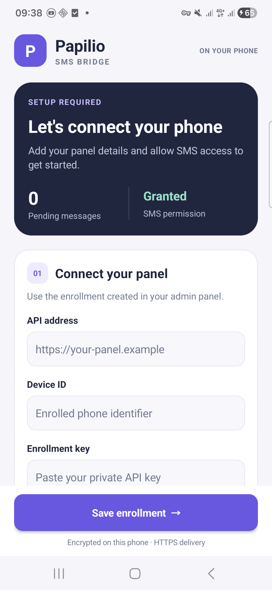

# Papilio SMS Bridge

A small Android application that forwards newly received bank-credit SMS to the
Papilio API. It uses Android Keystore encryption, a durable encrypted SQLite
outbox and Android JobScheduler. Incoming messages must match the configured exact
sender IDs and credit keywords. The application does not read the existing SMS inbox.

## Interface

Version 0.2.0 uses a native card layout with queue and SMS-permission status,
separate connection and bank-filter sections, collapsible delivery settings and
a persistent save action. Failed saves retain the form; drafts survive rotation
in memory without writing the enrollment key to Android's saved-state bundle.
Storage work stays off the UI thread. No web view or animation framework is used.

The updated APK was built, signature-verified, installed and visually inspected
on the owner's Samsung A54 on **2026-10-11**. SMS permission was visibly granted;
the phone remains unenrolled. This does not establish real-bank forwarding or
automatic settlement.



## Enroll a phone

1. Create an SMS device in the panel and select its payment destination and approval
   mode. Keep the API key private; ordinary device reads do not reveal it again.
2. Install the APK and open **Papilio SMS Bridge**.
3. Enter the trusted HTTPS API origin, enrolled device ID, API key, exact bank sender
   IDs and credit keywords. Save the enrollment and grant incoming SMS permission.
4. Check the queue and status after receiving a new matching SMS. Forwarded text
   that the bank parser cannot classify and ambiguous payment matches remain for
   administrator review. Text excluded by the phone's sender/keyword filters is
   not forwarded; review that SMS manually or adjust the filters.

Direct SMS observations preserve the Android provider timestamp and original
sender in the API's revision-1 origin contract. Signing covers the exact JSON body,
including that origin, and the enrolled device ID and request timestamp.

The initial message filters include `انتقال:` for the supplied Bank Melli format.
This also forwards matching negative-transfer text for server classification;
the phone does not approve payments. Existing saved filters are retained. A parser
profile can require `+` immediately after its selected deposit amount using
`required_amount_suffix`, so a balance or unrelated plus sign cannot settle an
order. Currency must be explicitly configured for formats without a currency label.

The phone needs network access to that HTTPS origin and a certificate trusted by
Android. A localhost HTTP development URL cannot be used directly. Redirects and
cleartext HTTP are rejected. Enrollment authenticates the phone; it does not turn
SMS into independent bank settlement evidence.

Delivery timeouts, retry interval, batch size, queue capacity, acknowledgement
capacity and response read chunk size are editable in the advanced delivery JSON.
Older saved enrollments inherit newly introduced delivery fields from the owning
asset defaults without rewriting stored values. A failed encrypted settings load
shows an explicit retry state and retains the saved enrollment. API rejection
pauses delivery
while retaining the queued event; correct enrollment/settings and select **Retry
pending uploads**. If the queue is full or storage fails, automatic forwarding of
that new message is not guaranteed: inspect the status and review the bank message
manually. No historical SMS import is implemented.

## Build

The standard project uses the Android Gradle plugin and Java 17. Configure the SDK
in an untracked `local.properties` or the environment and use your installed Gradle.
The project declares its SDK and application versions in `app/build.gradle.kts`.

When Gradle dependencies are unavailable, the installed Android SDK tools can
produce a locally signed APK:

```sh
python /absolute/project/android/sms-bridge/scripts/build_sdk_apk.py \
  --sdk /absolute/Android/Sdk \
  --java-home /absolute/jdk-17 \
  --build-tools 36.0.0 \
  --platform android-37.0 \
  --debug-keystore /private/path/android-bridge-debug.keystore
```

The selected platform must match the declared compile SDK. The fallback derives
application identity, minimum/target SDK and version from the existing Gradle
configuration and verifies the resulting signature. Its signing key is a local
Android debug key; use a proper release signing configuration for distribution.
Build output is `app/build/outputs/apk/debug/app-debug.apk` and is ignored by Git.

## USB installation

Unlock the phone, enable USB debugging, connect a data-capable USB cable and accept
its computer authorization prompt. Confirm an authorized device with
`adb devices -l`, then run:

```sh
adb install -r /absolute/project/android/sms-bridge/app/build/outputs/apk/debug/app-debug.apk
adb shell am start -n net.papilio.smsbridge/.MainActivity
```

Only an authorized device can be installed through ADB. Compilation and signature
verification do not establish actual SMS reception, battery-policy behavior or
end-to-end payment approval on a physical device.
