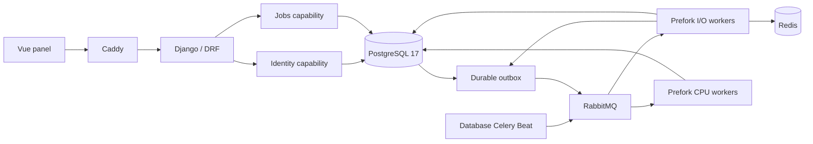
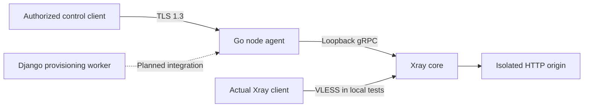

# Architecture and execution boundaries

The new backend lives in `panel/backend/src/papilio_panel`. The preserved Vue
workspace is `panel/frontend`; the Android bridge remains under `android`.

Modules expose explicit typed capability interfaces and bind implementations in
providers. App code owns permission and orchestration; infra owns ORM, broker,
cache and native error adaptation. Native Django model/migration discovery and
Celery task discovery remain authoritative. Sync WSGI and prefork execution are
used; no claim of ASGI/event-loop responsiveness is made.

Identity owns owner grants and authoritative Django principal reads. Jobs owns
the diagnostic operation aggregate, its transactional outbox, conditional claims,
worker observations and managed native Beat settings. No financial or network
capability is represented by a diagnostic operation.

## Delivery guarantees

An operation and outbox entry commit in one native `transaction.atomic` boundary.
Native Celery publication is confirmed by RabbitMQ, then dispatch is recorded.
A crash between publication and recording may deliver a duplicate; the consumer
conditionally claims DB operation identity and commits only its matching lease.
Unresolved messages are rescanned. This is not a distributed transaction or an
exactly-once guarantee for arbitrary external side effects.

Two worker roles have separate configured queues and prefork processes. A single
fixed-name Beat container is used per instance on its Docker host. This prevents
scaling a second Beat in that composition; distributed leadership across several
Docker hosts is not delivered.

## Native scheduler extension

The public `DatabaseScheduler.Entry` extension selects a native `ModelEntry`
subclass whose `save` persists only `last_run_at` and `total_run_count` using
Django's `save(update_fields=...)`. Native schedule discovery, clock, polling,
broker publication and change notifications remain in django-celery-beat. This
prevents a metadata save from overwriting a simultaneous operator edit and keeps
`date_changed` meaningful for optimistic configuration updates.

The installed 2.9.0 API and actual failure were inspected. References:
[database scheduler API](https://django-celery-beat.readthedocs.io/en/latest/reference/django-celery-beat.schedulers.html),
[Celery custom schedulers](https://docs.celeryq.dev/en/stable/userguide/periodic-tasks.html#using-custom-scheduler-classes).

## Subsequent modules

Customers, nodes, cores, subscriptions, products, orders, wallets, payments and
bots have distinct ownership. Panel and bot will call shared module capabilities.
Core-common identity/lifecycle will be separate from per-core settings and
credentials. Capabilities require real runtime/version probes. Go/mTLS node
management, Timescale telemetry, invoice policy snapshots and offline bot intake
are specified targets, not delivered implementations in this release.

## Network implementation on main

The current Go executable binds a node/deployment identity to mutual TLS and
adapts node-scoped HTTP requests to the official local Xray gRPC API. Its server
certificate carries the node's `/agent` URI, and the control client carries that
same node's `/control` URI. Native X.509 verification also runs per request so
an existing connection cannot extend an expired control credential's lifetime.

Tests exercise the complete solid-arrow path and the actual compiled agent.
Core process supervision, enrollment/rotation, Django provisioning, durable desired
state and public VPN transport remain pending. Diagnostic jobs do not stand in
for these capabilities. [Agent contract and limits](../node/agent/README.md).
